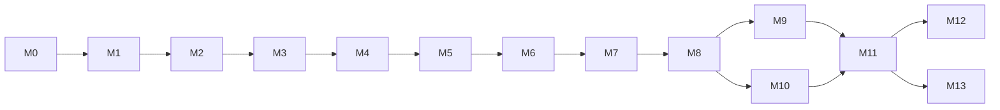

# Curriculum Map

**Linear Algebra, Made Visible** · extends [product spec v1.0](product-spec-v1.0.pdf) §6 · 2 November 2026

This document defines the whole course, from "what is a vector?" to the singular value decomposition and Jordan form. It is organised as one connected structure. Every concept has a single home, one fixed definition, a list of the concepts it requires, and links to the big ideas it belongs to. Lesson writers, reviewers and the app's prerequisite graph (spec §10) all work from it.

**How to use it**

- **Writing a lesson:** find its concepts in §5. Teach only those concepts, assume only what their *Requires* column lists, and use the notation in §8.
- **Adding a concept:** give it an ID, list what it requires, and place it after all of those requirements. If it doesn't fit anywhere, the structure needs a decision, not a workaround.
- **Reviewing:** check against the curation rules in §2.

---

## 1. What the research says, and the rule we take from it

| Finding | Source | Rule for this course |
|---|---|---|
| Students handle systems and matrix arithmetic well but get "confused and disoriented" at subspaces, spanning and linear independence | Carlson 1993; Harel 1989; Wang 1989 (via UMD review) | Spend the most lessons, visuals and practice on Level 2 (span, independence, basis, subspaces), not on arithmetic |
| The "obstacle of formalism": students manipulate symbols without meaning. The cure is not to drop formal definitions but to place them carefully relative to what students already know | Dorier 1998; Dorier & Sierpinska 2001 | A formal definition appears only after the learner has met the idea and needs it (spec §5 step 6) |
| A course that starts with geometry and generalises only from it leaves many students stuck with "vectors are arrows" | Dorier & Sierpinska 2001; Harel 2000 | Every major concept also appears in at least one setting that isn't arrows, such as price lists, data or polynomials. Abstract vector spaces arrive in Module 6, not at the end |
| Linear algebra uses three modes of thinking: geometric (pictures), arithmetic (numbers and matrices) and structural (definitions and properties). They are most useful when learners move between them | Sierpinska 2000 | Every concept is shown in all three modes, and practice includes tasks that translate between them, such as "draw this matrix" or "write this picture as an equation" |
| Necessity principle: learners need an intellectual reason for a concept before they will build it | Harel 2000 | Every module opens with a driving question the learner can't answer yet |
| Learners who rely on prototypical examples instead of the definition misjudge new cases; students often don't connect matrices with transformations | 2016 study on prototypical examples; Slye 2019 | Every concept has examples **and** non-examples, such as "translation is not linear" |
| Common eigenvector errors: assuming any set of eigenvectors is independent, and confusing the weights in a combination with eigenvalues | Wawro, Watson & Zandieh 2019 | These errors are in Module 9's misconception list and get targeted practice |
| Students use several different strategies to decide whether a vector is in a span; checking the strategy reveals more than marking the answer | Gerami et al. 2024 | Span practice asks "how did you decide?" and records the strategy |
| Updated curriculum guidance stresses linear maps, their composition and inverses, diagonalisation and the SVD | LACSG 2.0 (Stewart et al. 2022) | Transformations are a thread from Module 3 onward; the SVD (Module 12) is the course's capstone |
| A learner's mental picture of a concept can conflict with its formal definition | Tall & Vinner 1981 | Each concept has one canonical definition (§9), and every picture must agree with it |
| Prerequisite links and "covers" links are different kinds of relationship; practising an advanced topic also reviews the simpler topics it covers | Math Academy / Skycak | The concept graph records `requires` links now and can add `covers` links later for spaced review (spec §10) |

---

## 2. Curation rules: how we keep concepts clean

1. **One home per concept.** Each concept is defined in exactly one lesson. Everywhere else links back to it.
2. **One definition.** The glossary entry is the definition. Lessons quote it word for word and never paraphrase it into something subtly different.
3. **Prerequisites come first.** A lesson may use only concepts in its *Requires* chain. When an idea appears early informally (for example area scaling in the matrix lab before determinants), it is labelled **Preview** and links forward to its home.
4. **Three modes, plus a setting that isn't arrows.** Every concept is shown as a picture, as numbers and as a definition, and appears in at least one non-geometric setting.
5. **Examples and non-examples.** Every definition comes with at least one near-miss that fails it.
6. **Revisit, don't redefine.** When a concept grows (the dot product gains a geometric meaning in Module 10), the later lesson extends the original home and links back to it. It doesn't create a second definition.
7. **One notation.** Use §8 everywhere. Other textbooks' notation appears only in the alias table.
8. **Real numbers until stated otherwise.** All scalars are real until Module 9 introduces complex eigenvalues, and that switch is announced.
9. **An example is not a proof.** Worked numbers are labelled *Illustration* (spec §9); general claims link to a proof or theorem.
10. **Machine-checked.** Once the graph is stored as data, CI checks that it has no cycles, that every `requires` link points to an existing concept, and that every glossary term used in a lesson is defined upstream.

---

## 3. Seven threads that connect the course

Threads are the big ideas that come back in every level. Each module states which threads it advances, and each module recap ends with a one-line "thread check", such as "Where have you seen linear combinations before?"

| Thread | First appears | Develops in | Ends in |
|---|---|---|---|
| **T1 Linear combination**: everything is built from scaled sums | M1 `linear-combination` | M2 column picture, M3 Ax, M5 span, M6 coordinates | M12: A as a sum of rank-1 pieces σᵢuᵢvᵢᵀ |
| **T2 Transformation**: a matrix *does* something | M3 `linear-transformation` | M4 undo, M7 matrix in any basis, M8 volume scale, M9 invariant directions | M12: every matrix = rotate · stretch · rotate |
| **T3 Solving Ax = b**: does a solution exist, and is it unique? | M2 `linear-system` | M4 IMT, M5 span membership, M6 Col/Nul and rank–nullity | M10 least squares → M12 pseudoinverse |
| **T4 Good coordinates**: pick the basis that makes the problem easy | M6 `coordinates` | M7 change of basis, M9 eigenbasis, M10 orthonormal basis | M11 principal axes → M12 singular vectors |
| **T5 Measuring**: length, angle, area, size | M1 `vector-length` | M8 volume, M10 angle and projection | M12 singular values, condition number |
| **T6 Invariants**: what stays the same | M2 solution set under row operations | M6 rank and dimension, M7 trace, M8 det under replacement, M9 eigenvalues | M13 Sylvester's law of inertia |
| **T7 Factorisations**: a matrix as a product of simple pieces | M4 LU | M6 CR, M9 PDP⁻¹, M10 QR, M11 QΛQᵀ | M12 UΣVᵀ |

### The Invertible Matrix Theorem grows with the course

For a square n × n matrix A, the following statements are all equivalent. Rather than presenting the theorem once, each module adds the conditions it has just made meaningful, and the learner watches it grow. It is a running summary that connects the course.

| Stage | Module | Conditions added |
|---|---|---|
| `imt-stage-1` | M4 | A is invertible · Ax = b has exactly one solution for every b · Ax = 0 has only the zero solution · A has n pivots · RREF(A) = I |
| `imt-stage-2` | M5 | The columns are linearly independent · the columns span ℝⁿ |
| `imt-stage-3` | M6 | The columns form a basis of ℝⁿ · rank A = n · Nul(A) = {0} · Col(A) = ℝⁿ |
| `imt-stage-4` | M8 | det A ≠ 0 · x ↦ Ax is one-to-one and onto · Aᵀ is invertible |
| `imt-stage-5` | M9 | 0 is not an eigenvalue of A |
| `imt-stage-6` | M12 | All n singular values are positive |

---

## 4. Course at a glance

| Level | Module | Driving question | Treil chapter* |
|---|---|---|---|
| **0 Foundations** | M0 Mathematical warm-up | What exactly is this symbol asking me to do? | — |
| **1 Concrete** | M1 Vectors | How do I describe a move, or a shopping basket, with numbers, and combine them? | 1 |
| | M2 Systems and elimination | When does a set of equations have one answer, none, or infinitely many? | 2 |
| | M3 Matrices as transformations | What does a matrix *do* to space? | 1 |
| | M4 Inverses | Can a transformation be undone, and how would I know? | 1, 2 |
| **2 Structure** | M5 Span and independence | Using only these directions, where can I get to, and is any direction redundant? | 1, 2 |
| | M6 Subspaces, basis, dimension | What is the smallest set of building blocks for a space? | 1, 2 |
| | M7 Linear transformations and change of basis | If I change my ruler, what changes and what stays the same? | 1, 2 |
| **3 Measurement** | M8 Determinants | How much does a transformation stretch volume, and when does it flatten space? | 3 |
| | M9 Eigenvalues and eigenvectors | Which directions does a transformation only stretch, and what happens if I apply it again and again? | 4 |
| | M10 Orthogonality and least squares | What is the closest I can get when I can't hit the target exactly? | 5 |
| **4 Advanced** | M11 Symmetric matrices and quadratic forms | Is this surface a bowl, a dome or a saddle? | 6, 7 |
| | M12 Singular value decomposition | What are the most important directions in *any* matrix? | 6 |
| | M13 Advanced structure (second course) | What does a transformation look like when it can't be diagonalised? | 8, 9 |

\*Chapter-level mapping to Treil's *Linear Algebra Done Wrong*, based on its published contents. Check it against your edition. Treil defines abstract vector spaces in Chapter 1; here they arrive in M6 (see §1). Treil's instructor notes say Chapters 4 and 5 are largely independent, which matches M9 and M10 below.

### Dependency graph between modules

**M9 (eigenvalues) and M10 (orthogonality) don't depend on each other**, so they can be taught in either order. The default puts eigenvalues first because the determinant is still fresh from M8, which also matches Treil, *Understanding Linear Algebra* and *Interactive Linear Algebra*. M11 needs both.

### Changes from the spec's module list (§6)

| Spec module | Here | Why |
|---|---|---|
| 0–2 | M0–M2 | Unchanged |
| 3 Matrices as transformations | M3 + M4 | Inverses get their own module, so "undo" becomes the entry point to the IMT |
| 4 Span, independence, basis | M5 + M6 | This is the hardest area according to the research, so it gets two modules |
| 5 Linear maps and change of basis | M7 | Unchanged in content, but now comes after rank and null space, which it relies on |
| 6 Determinants | M8 | Moved after change of basis so that "similar matrices have equal determinants" can be proved here |
| 7 Rank, kernel, image, four subspaces | Split into M6 (rank, null and column space, four subspaces) and M7 (kernel, image, one-to-one/onto) | In the spec's order, Module 5 used ideas that were only defined in Module 7 |
| 8 Inner products | M10 | Independent of eigenvalues; either order works |
| 9 Eigenvalues | M9 | — |
| *(new)* | M11, M12, M13 | Covers the advanced end; economics needs definiteness, and LACSG 2.0 emphasises the SVD |
| 10 Proof studio | Proof track P1–P7 (§6) | Proof skills are taught alongside the concepts they're about. The Proof studio screen remains as the tool |
| 11 Exam practice | Practice mode across all modules | It's a way of practising, not a topic |

The three Phase 1 labs (vector playground, row-reduction theatre, matrix transformation lab) belong to M1, M2 and M3, so [the build plan](early-build-plan.md) doesn't change.

---

## 5. Modules

Tags: **[econ]** economics application · **[data]** data application · **[opt]** optional or enrichment. A concept is core unless it is tagged.

### M0 · Mathematical warm-up
**Visual:** coordinate plane, equation balance · **Threads:** none yet · **Exit check:** "Rewrite *for every b there is an x with Ax = b* in plain words."

| ID | Concept | Requires |
|---|---|---|
| `real-numbers-fractions` | Signed numbers, fractions, exact vs approximate values | — |
| `coordinate-plane` | Points in the plane and in space | `real-numbers-fractions` |
| `functions-basics` | A function as an input → output rule; domain and codomain | — |
| `linear-equation-one` | Solving one linear equation | `real-numbers-fractions` |
| `sum-notation` | Σ notation and indices | — |
| `sets-notation` | Sets, ∈, ⊆, ℝⁿ, "for all", "there exists" | — |
| `proof-reading-definitions` | Reading a definition and an if–then statement (P1) | `sets-notation` |

### M1 · Vectors
**Visual:** Vector playground (Phase 1 lab) · **Beyond arrows:** a shopping basket q and a price list p, where p·q is the total cost; a row of exam scores · **Threads:** T1, T5

| ID | Concept | Requires |
|---|---|---|
| `vector-rn` | A vector as an ordered list in ℝⁿ, written as a column | `coordinate-plane`, `sets-notation` |
| `vector-arrow` | A vector as a displacement arrow, not a fixed position | `vector-rn` |
| `vector-addition` | Adding vectors, tip-to-tail and component by component | `vector-arrow` |
| `scalar-multiplication` | Scaling a vector, including by negative numbers and zero | `vector-arrow` |
| `linear-combination` | c₁v₁ + … + cₖvₖ | `vector-addition`, `scalar-multiplication` |
| `dot-product` | u·v as a weighted sum | `vector-rn`, `sum-notation` |
| `vector-length` | Length ‖v‖ = √(v·v) | `dot-product`, `coordinate-plane` |

**Misconceptions:** a vector is tied to the origin; adding vectors adds their lengths; the dot product gives a vector.
**Exit check:** "Write (4, 1) as a combination of (1, 0) and (1, 1)."

### M2 · Systems and elimination
**Visual:** Row-reduction theatre (Phase 1 lab), with a toggle between the row picture and the column picture · **Beyond arrows:** mixing problems; equilibrium in a two-good market · **Threads:** T1, T3, T6

| ID | Concept | Requires |
|---|---|---|
| `linear-system` | A system of linear equations and its solution set | `linear-equation-one`, `vector-rn` |
| `row-picture` | Each equation is a line or plane; solutions are where they meet | `linear-system`, `coordinate-plane` |
| `column-picture` | Which combination of the columns produces b? | `linear-system`, `linear-combination` |
| `augmented-matrix` | Recording a system as [A \| b] | `linear-system` |
| `elementary-row-ops` | Swap, scale by a non-zero number, replace; each can be undone | `augmented-matrix` |
| `row-ops-preserve-solutions` | Why row operations never change the solution set | `elementary-row-ops`, `row-picture` |
| `echelon-form` | Echelon form and pivots | `elementary-row-ops` |
| `rref` | Reduced row echelon form | `echelon-form` |
| `solution-cases` | No solution, exactly one, or infinitely many, read from the pivots | `rref`, `row-ops-preserve-solutions` |
| `free-variables` | Free variables and solutions in parametric form | `solution-cases` |
| `homogeneous-systems` | Systems whose right-hand sides are all 0 always have the zero solution | `free-variables` |
| `general-solution-structure` | Every solution = one particular solution + a solution of the homogeneous system | `homogeneous-systems`, `linear-combination` |

**Misconceptions:** row operations change the answer; multiplying a row by 0 is allowed; a row of zeros [0 0 \| 0] means "no solution" (it means a redundant equation; only [0 0 \| c] with c ≠ 0 means no solution); a free variable means "no solution".
**Exit check:** "Without solving, explain why this system has infinitely many solutions."

### M3 · Matrices as transformations
**Visual:** Matrix transformation lab (Phase 1 lab). For composition, apply two matrices one after the other, then swap their order. · **Beyond arrows:** a recipe matrix that turns "dishes ordered" into "ingredients needed" · **Threads:** T1, T2

| ID | Concept | Requires |
|---|---|---|
| `matrix-basics` | Size m × n, entries aᵢⱼ, columns a₁ … aₙ | `vector-rn` |
| `matrix-vector-product` | Ax as a combination of A's columns, plus the row-by-row dot-product view | `matrix-basics`, `linear-combination`, `dot-product` |
| `system-as-ax-b` | A system written as Ax = b | `matrix-vector-product`, `column-picture` |
| `linear-transformation` | T(u + v) = T(u) + T(v) and T(cv) = cT(v) | `functions-basics`, `linear-combination` |
| `linear-non-examples` | Translation, squaring, adding a constant: why each fails | `linear-transformation` |
| `standard-matrix` | The columns of A are where e₁, …, eₙ land | `linear-transformation`, `matrix-vector-product` |
| `geometric-maps-2d` | Scaling, rotation, reflection, shear and projection in ℝ² | `standard-matrix` |
| `matrix-product` | AB means "do B, then A"; the size rule; the columns of AB are Abⱼ | `standard-matrix` |
| `matrix-algebra-rules` | Associative and distributive but not commutative; the identity I | `matrix-product` |
| `transpose` | Aᵀ: rows become columns; (AB)ᵀ = BᵀAᵀ | `matrix-basics`, `matrix-product` |

**Misconceptions:** AB = BA; matrices multiply entry by entry; translation is linear; I behaves like the number 1 in every respect (spec §9); Ax makes sense when the sizes don't match.
**Exit check:** "Find the matrix that rotates by 90° and then reflects in the x-axis. Does the order matter?"

### M4 · Inverses
**Visual:** an "undo" button that applies A and then A⁻¹. A singular matrix flattens the plane, and undo becomes impossible. · **Beyond arrows:** decoding a message; the Leontief input–output model · **Threads:** T2, T3, T7

| ID | Concept | Requires |
|---|---|---|
| `invertible-transformation` | A transformation that can be undone | `matrix-product` |
| `inverse-matrix` | A⁻¹ with AA⁻¹ = A⁻¹A = I | `invertible-transformation`, `matrix-algebra-rules` |
| `inverse-2x2` | The 2 × 2 inverse formula (previews the determinant) | `inverse-matrix` |
| `elementary-matrices` | Each row operation is multiplication on the left by an elementary matrix | `elementary-row-ops`, `matrix-product` |
| `inverse-by-row-reduction` | Finding A⁻¹ by reducing [A \| I] | `elementary-matrices`, `rref`, `inverse-matrix` |
| `inverse-of-product` | (AB)⁻¹ = B⁻¹A⁻¹: undo in reverse order | `inverse-matrix` |
| `lu-factorization` [opt] | A = LU: elimination recorded as a matrix | `elementary-matrices` |
| `imt-stage-1` | IMT stage 1 (§3) | `inverse-by-row-reduction`, `solution-cases`, `system-as-ax-b` |
| `app-leontief` [econ] | Input–output model: (I − A)x = d | `inverse-matrix`, `system-as-ax-b` |

**Misconceptions:** (AB)⁻¹ = A⁻¹B⁻¹; every square matrix has an inverse; the transpose is the inverse (true only for orthogonal matrices, M10).

### M5 · Span and linear independence
**Visual:** a span sweeper. Coefficient sliders paint the region you can reach; adding a third vector inside the plane shows redundancy. · **Beyond arrows:** can these feed mixes produce a target nutrient profile? (in the style of the "magic carpet" travel tasks from inquiry-oriented linear algebra) · **Threads:** T1, T3

| ID | Concept | Requires |
|---|---|---|
| `span` | span{v₁, …, vₖ}: every point reachable by combinations | `linear-combination` |
| `span-membership` | b is in the span ⇔ the system is consistent | `span`, `system-as-ax-b`, `solution-cases` |
| `spanning-set` | The columns span ℝᵐ ⇔ there is a pivot in every row | `span-membership`, `echelon-form` |
| `linear-dependence` | Some vector is a combination of the others (redundancy) | `span` |
| `linear-independence` | Only the all-zero combination gives 0 | `linear-dependence`, `homogeneous-systems` |
| `independence-test` | The columns are independent ⇔ there is a pivot in every column | `linear-independence`, `echelon-form`, `system-as-ax-b` |
| `span-geometry` | Spans are points, lines, planes …; dependence loses a dimension | `span`, `linear-independence` |
| `imt-stage-2` | IMT stage 2 | `imt-stage-1`, `spanning-set`, `independence-test` |
| `proof-direct-linear-combo` | Direct proofs with linear combinations (P2) | `linear-independence`, `proof-reading-definitions` |

**Misconceptions:** "span" means the vectors themselves; checking pairs is enough (three vectors in a plane can be pairwise non-parallel yet dependent); a set containing 0 can be independent; confusing "dependent" with "independent" (UKZN study).
**Exit check:** "Can three vectors in ℝ² be independent? Explain using pivots *and* a picture."

### M6 · Subspaces, basis and dimension
**Visual:** a subspace checker (try to leave the set by adding or scaling); a basis builder; a rank–nullity bar showing columns = rank + nullity · **Beyond arrows:** polynomials of degree ≤ 2 as vectors, with basis 1, x, x²; the solution set of a homogeneous system · **Threads:** T3, T4, T6

| ID | Concept | Requires |
|---|---|---|
| `subspace` | Contains 0 and is closed under addition and scaling | `span`, `sets-notation` |
| `subspace-non-examples` | A line not through 0, the two axes together, a quadrant | `subspace` |
| `vector-space-abstract` | The same rules for other objects: polynomials, matrices, functions, sequences | `subspace`, `linear-combination` |
| `basis` | A linearly independent spanning set | `subspace`, `span`, `linear-independence` |
| `coordinates` | [v]_B: the weights that build v from basis B | `basis` |
| `dimension` | Every basis of a space has the same size | `basis` |
| `column-space` | Col(A) = span of the columns = every b that can be reached | `subspace`, `span-membership` |
| `null-space` | Nul(A) = every solution of Ax = 0 | `subspace`, `homogeneous-systems`, `system-as-ax-b` |
| `row-space` | Row(A) = span of the rows; row operations don't change it | `subspace`, `transpose`, `elementary-row-ops` |
| `rank` | rank A = dim Col(A) = number of pivots | `column-space`, `dimension`, `echelon-form` |
| `rank-nullity` | rank A + dim Nul(A) = number of columns | `rank`, `null-space`, `free-variables` |
| `four-subspaces` | Col(A), Nul(A), Row(A), Nul(Aᵀ) and their dimensions | `rank-nullity`, `row-space` |
| `cr-factorization` [opt] | A = CR: the pivot columns times the non-zero rows of RREF | `rank`, `rref`, `matrix-product` |
| `imt-stage-3` | IMT stage 3 | `imt-stage-2`, `rank-nullity` |
| `proof-subspace` | Proving a set is, or isn't, a subspace (P3) | `subspace-non-examples`, `proof-direct-linear-combo` |

**Misconceptions:** every line is a subspace; a space has only one basis; "the dimension of a matrix" (matrices have a *size*); a basis for Col(A) is the pivot columns of the *echelon form* (it's the pivot columns of the original A); row operations preserve the column space (they preserve the row space and null space).

### M7 · Linear transformations and change of basis
**Visual:** two grids side by side showing the same vector in standard and basis-B coordinates, with arrows labelled P_{std←B} and P_{B←std} (spec §7) · **Beyond arrows:** d/dx as a linear transformation on polynomials, with its own matrix; changing currencies or units · **Threads:** T2, T4, T6

| ID | Concept | Requires |
|---|---|---|
| `linear-transformation-general` | Linear transformations between any vector spaces, e.g. d/dx on polynomials | `linear-transformation`, `vector-space-abstract` |
| `kernel-image` | ker T and im T; for T(x) = Ax they are Nul(A) and Col(A) | `linear-transformation-general`, `null-space`, `column-space` |
| `injective-surjective` | One-to-one ⇔ ker T = {0}; onto ⇔ im T is the whole codomain | `kernel-image`, `rank-nullity` |
| `isomorphism` | Spaces with the same structure, e.g. P₂ ≅ ℝ³ via coordinates | `injective-surjective`, `coordinates` |
| `matrix-of-transformation` | [T]_{C←B}: the matrix of T in chosen bases | `coordinates`, `standard-matrix`, `linear-transformation-general` |
| `change-of-basis` | P_{C←B} converts B-coordinates into C-coordinates; its inverse converts back | `coordinates`, `inverse-matrix` |
| `similarity` | B = P⁻¹AP: the same transformation in different coordinates | `matrix-of-transformation`, `change-of-basis` |
| `trace` | tr A = sum of the diagonal entries; tr(XY) = tr(YX) | `matrix-product` |
| `similarity-invariants` | Similar matrices share trace and rank (determinant and eigenvalues follow in M8 and M9) | `similarity`, `trace`, `rank` |
| `proof-contradiction-counterexample` | Proof by contradiction and by counterexample (P4) | `proof-subspace`, `injective-surjective` |

**Misconceptions:** mixing up P_{std←B} and its inverse (spec §8C); similar means equal; changing basis changes the vector itself (it only changes the coordinates).

### M8 · Determinants
**Visual:** Determinant explorer (spec §7): the unit square becomes a parallelogram; row-operation buttons show their multipliers · **Beyond arrows:** comparative statics in a two-market model · **Threads:** T5, T6

| ID | Concept | Requires |
|---|---|---|
| `det-area-volume` | det A = signed area/volume scale factor; the sign gives orientation | `geometric-maps-2d`, `span-geometry` |
| `det-properties` | The defining properties: linear in each column, swapping columns flips the sign, det I = 1 | `det-area-volume` |
| `det-small-formulas` | 2 × 2 and 3 × 3 formulas | `det-properties`, `inverse-2x2` |
| `det-row-ops` | Swap: × (−1); scale a row by α: × α; replace: unchanged | `det-properties`, `elementary-row-ops` |
| `det-by-elimination` | det = ± the product of the pivots | `det-row-ops`, `echelon-form` |
| `det-cofactor` | Cofactor expansion | `det-small-formulas` |
| `det-product` | det(AB) = det A · det B | `det-area-volume`, `matrix-product`, `elementary-matrices` |
| `det-transpose` | det(Aᵀ) = det A | `det-product`, `transpose` |
| `det-invertibility` | det A ≠ 0 ⇔ A is invertible; det(A⁻¹) = 1/det A | `det-by-elimination`, `det-product`, `imt-stage-3` |
| `det-similarity` | Similar matrices have equal determinants | `det-product`, `similarity` |
| `cramers-rule` | Cramer's rule and the adjugate formula for A⁻¹ | `det-cofactor`, `inverse-matrix`, `system-as-ax-b` |
| `app-comparative-statics` [econ] | Comparative statics in linear market and macro models using Cramer's rule | `cramers-rule` |
| `imt-stage-4` | IMT stage 4 | `imt-stage-3`, `det-invertibility`, `det-transpose`, `injective-surjective` |
| `proof-iff` | If-and-only-if proofs and chains of equivalences (P5) | `imt-stage-4`, `proof-contradiction-counterexample` |

**Misconceptions:** every row operation keeps the determinant (spec §8B); det(A + B) = det A + det B; det(cA) = c · det A (it's cⁿ · det A); a numerical check of det(Aᵀ) = det A proves it (spec §8A).

### M9 · Eigenvalues and eigenvectors
**Visual:** Eigenvector lab (spec §7): vectors that stay on their own line; a trail showing repeated application · **Beyond arrows:** migration between regions as a Markov chain; a growth model xₖ₊₁ = Axₖ · **Threads:** T2, T4, T6, T7

| ID | Concept | Requires |
|---|---|---|
| `eigen-definition` | Av = λv with v ≠ 0: a direction that A only stretches | `matrix-vector-product`, `span-geometry` |
| `eigenspace` | E_λ = Nul(A − λI) | `eigen-definition`, `null-space` |
| `characteristic-polynomial` | Eigenvalues are the solutions of det(A − λI) = 0 | `eigenspace`, `det-invertibility` |
| `eigen-computation` | Finding eigenvalues and eigenvectors for 2 × 2 and 3 × 3 matrices | `characteristic-polynomial` |
| `complex-eigenvalues` | Rotations have no real eigenvector; complex pairs mean rotate-and-scale | `eigen-computation`, `geometric-maps-2d` |
| `multiplicity` | Algebraic vs geometric multiplicity | `eigen-computation`, `eigenspace`, `dimension` |
| `eigen-independence` | Eigenvectors for distinct eigenvalues are independent | `eigenspace`, `linear-independence` |
| `diagonalization` | A = PDP⁻¹ when there is a basis of eigenvectors | `eigen-independence`, `multiplicity`, `similarity` |
| `non-diagonalizable` | Shears: not enough eigenvectors | `diagonalization` |
| `matrix-powers` | Aᵏ = PDᵏP⁻¹ | `diagonalization` |
| `dynamical-systems` | xₖ₊₁ = Axₖ; long-run behaviour from the eigenvalues | `matrix-powers` |
| `markov-chains` [econ] | Transition matrices; the steady state is an eigenvector for λ = 1 | `dynamical-systems` |
| `power-method` [opt] | Finding the dominant eigenvector by repeated multiplication | `dynamical-systems` |
| `eigen-trace-det` | tr A = sum of the eigenvalues; det A = their product | `characteristic-polynomial`, `similarity-invariants`, `det-similarity` |
| `imt-stage-5` | IMT stage 5 | `imt-stage-4`, `characteristic-polynomial` |
| `proof-induction` | Proof by induction (P6), e.g. Aᵏv = λᵏv | `matrix-powers`, `proof-direct-linear-combo` |

**Misconceptions:** the zero vector can be an eigenvector; any set of eigenvectors is independent, and the weights in a combination are eigenvalues (Wawro et al. 2019); every matrix is diagonalisable; a repeated eigenvalue means it isn't diagonalisable (the identity matrix is a counterexample); every real matrix has real eigenvalues (spec §7).

### M10 · Orthogonality and least squares
**Visual:** Projection lab (spec §7): the shadow and the perpendicular residual; fitting a line to data as a projection · **Beyond arrows:** fitting a demand line to price and quantity data · **Threads:** T3, T4, T5, T7

| ID | Concept | Requires |
|---|---|---|
| `dot-product-geometry` | u·v = ‖u‖‖v‖ cos θ; Cauchy–Schwarz | `dot-product`, `vector-length` |
| `orthogonality` | u·v = 0; Pythagoras in ℝⁿ | `dot-product-geometry` |
| `transpose-meaning` | (Ax)·y = x·(Aᵀy): what the transpose really is | `transpose`, `orthogonality`, `matrix-vector-product` |
| `orthogonal-complement` | W^⊥ | `orthogonality`, `subspace` |
| `four-subspaces-orthogonal` | Row(A) ⊥ Nul(A) and Col(A) ⊥ Nul(Aᵀ) | `orthogonal-complement`, `four-subspaces`, `transpose-meaning` |
| `orthonormal-basis` | Orthogonal and orthonormal bases make coordinates easy | `orthogonality`, `basis`, `coordinates` |
| `projection-line` | Projecting onto a line | `orthogonality` |
| `projection-subspace` | Projecting onto a subspace; the residual is orthogonal to it | `projection-line`, `orthogonal-complement`, `orthonormal-basis` |
| `gram-schmidt` | Turning any basis into an orthonormal one | `projection-subspace` |
| `orthogonal-matrices` | QᵀQ = I; they preserve lengths and angles; det = ±1 | `orthonormal-basis`, `transpose-meaning`, `det-product` |
| `qr-factorization` | A = QR | `gram-schmidt`, `orthogonal-matrices` |
| `least-squares` | The best approximate solution: AᵀAx̂ = Aᵀb | `projection-subspace`, `four-subspaces-orthogonal`, `inverse-matrix` |
| `app-regression` [econ] | OLS: β̂ = (XᵀX)⁻¹Xᵀy; fitted values are a projection | `least-squares` |
| `inner-product-spaces` [opt] | General inner products, e.g. on functions | `dot-product-geometry`, `vector-space-abstract` |

**Misconceptions:** orthogonal means orthonormal; you can project onto a span by adding the projections onto each vector (only valid for an *orthogonal* basis); x̂ solves Ax = b (it solves AᵀAx̂ = Aᵀb); an "orthogonal matrix" only needs orthogonal columns (they must be orthonormal).

### M11 · Symmetric matrices and quadratic forms
**Visual:** a surface and contour plot of xᵀAx, with principal axes that rotate into view: bowl, dome or saddle · **Beyond arrows:** profit-maximising second-order conditions; portfolio risk wᵀΣw · **Threads:** T4, T6, T7

| ID | Concept | Requires |
|---|---|---|
| `symmetric-matrices` | Aᵀ = A | `transpose` |
| `spectral-theorem` | Real symmetric ⇒ real eigenvalues and orthonormal eigenvectors: A = QΛQᵀ | `symmetric-matrices`, `diagonalization`, `orthogonal-matrices` |
| `quadratic-forms` | Q(x) = xᵀAx with A symmetric | `symmetric-matrices`, `dot-product` |
| `principal-axes` | Rotating to the principal axes removes the cross terms | `quadratic-forms`, `spectral-theorem` |
| `definiteness` | Positive/negative (semi)definite or indefinite, from the signs of the eigenvalues | `principal-axes` |
| `sylvester-criterion` | Leading principal minors test for definite; *all* principal minors test for semidefinite | `definiteness`, `det-cofactor` |
| `app-second-order` [econ] | The Hessian test for a local maximum or minimum | `sylvester-criterion` |
| `app-bordered-hessian` [econ] | Definiteness under constraints (needs Lagrange multipliers from calculus) | `app-second-order` |
| `cholesky` [opt] | A = LLᵀ for positive definite A | `definiteness`, `lu-factorization` |
| `proof-symmetric` | Proofs about orthogonality and symmetric matrices (P7) | `spectral-theorem`, `proof-iff` |

**Misconceptions:** positive definite means all entries are positive; leading principal minors ≥ 0 shows positive *semi*definite (you need all principal minors, a common exam trap); using a non-symmetric matrix for a quadratic form.

### M12 · Singular value decomposition
**Visual:** the unit circle becomes an ellipse, with singular vectors marked; an image-compression slider for rank k · **Beyond arrows:** compressing a ratings table; principal components of economic indicators · **Threads:** all seven come together here

| ID | Concept | Requires |
|---|---|---|
| `svd-geometry` | Every matrix maps the unit circle/sphere to an ellipse: A = UΣVᵀ | `spectral-theorem`, `orthogonal-matrices` |
| `svd-computation` | Singular values from AᵀA | `svd-geometry` |
| `svd-subspaces` | Singular vectors give orthonormal bases for the four subspaces | `svd-computation`, `four-subspaces-orthogonal` |
| `low-rank-approximation` | Keeping the largest σ's gives the best rank-k approximation | `svd-computation` |
| `pseudoinverse` | A⁺, and least squares revisited | `svd-subspaces`, `least-squares` |
| `pca` [data] | Principal component analysis | `low-rank-approximation`, `spectral-theorem` |
| `condition-number` [opt] | σ_max / σ_min: how sensitive Ax = b is to small errors | `svd-computation`, `system-as-ax-b` |
| `polar-decomposition` [opt] | A = (rotation)(stretch) | `svd-computation` |
| `imt-stage-6` | IMT final stage | `imt-stage-5`, `svd-computation` |

**Misconceptions:** singular values are the eigenvalues (only for symmetric positive semidefinite matrices); the SVD exists only for square matrices.

### M13 · Advanced structure (second course)
**Visual:** a Jordan block as shear plus scaling; phase portraits for x′ = Ax · **Beyond arrows:** continuous-time growth models · **Threads:** T4, T6, T7

| ID | Concept | Requires |
|---|---|---|
| `complex-vector-spaces` | Vectors and matrices with complex entries; the conjugate transpose | `complex-eigenvalues`, `transpose-meaning` |
| `schur` | Every square matrix is unitarily triangularisable | `complex-vector-spaces`, `orthogonal-matrices`, `characteristic-polynomial` |
| `normal-unitary` | Normal and unitary matrices; the spectral theorem over ℂ | `schur`, `spectral-theorem` |
| `cayley-hamilton` | A satisfies its own characteristic polynomial | `characteristic-polynomial`, `matrix-powers` |
| `minimal-polynomial` | The smallest polynomial that A satisfies | `cayley-hamilton` |
| `invariant-subspaces` | Subspaces that a transformation maps into themselves | `eigenspace`, `linear-transformation-general` |
| `generalized-eigenvectors` | Filling the gaps when eigenvectors run out | `non-diagonalizable`, `invariant-subspaces`, `multiplicity` |
| `jordan-form` | The simplest matrix similar to A | `generalized-eigenvectors`, `minimal-polynomial` |
| `linear-ode-systems` [econ] | x′ = Ax and the matrix exponential | `diagonalization`, `complex-eigenvalues` |
| `dual-spaces` | Linear functionals and the dual basis | `linear-transformation-general`, `basis` |
| `bilinear-forms-tensors` | Bilinear forms, Sylvester's law of inertia, tensors | `dual-spaces`, `quadratic-forms` |

---

## 6. Proof track

Proof skills are taught where the concepts they use first appear. The Proof studio screen (spec §11) is where learners practise them.

| ID | Skill | Module | Example task |
|---|---|---|---|
| `proof-reading-definitions` (P1) | Reading definitions, quantifiers, if–then | M0 | "What would it take to show this statement is *false*?" |
| `proof-direct-linear-combo` (P2) | Direct proof with linear combinations | M5 | "If u and v are in span{a, b}, show that u + v is too." |
| `proof-subspace` (P3) | Subspace proofs and counterexamples | M6 | "Is {(x, y) : xy ≥ 0} a subspace? Prove it or give a counterexample." |
| `proof-contradiction-counterexample` (P4) | Contradiction and contrapositive | M7 | "Show that no linear transformation ℝ³ → ℝ² is one-to-one." |
| `proof-iff` (P5) | If-and-only-if and equivalence chains | M8 | "Prove that A is invertible ⇔ det A ≠ 0, using IMT stage 3." |
| `proof-induction` (P6) | Induction | M9 | "Show that Aᵏv = λᵏv for every k ≥ 1." |
| `proof-symmetric` (P7) | Orthogonality arguments | M11 | "Show that eigenvectors of a symmetric matrix for different eigenvalues are orthogonal." |

---

## 7. Applications thread

Each application lives in one module and declares its prerequisites like any other concept, so it never appears before the maths it needs.

| Application | Module | Built on |
|---|---|---|
| Price × quantity = total cost | M1 | `dot-product` |
| Two-good market equilibrium | M2 | `linear-system` |
| Leontief input–output model [econ] | M4 | `inverse-matrix` |
| Comparative statics with Cramer's rule [econ] | M8 | `cramers-rule` |
| Markov chains and long-run shares [econ] | M9 | `dynamical-systems` |
| Growth and stability, xₖ₊₁ = Axₖ | M9 | `matrix-powers` |
| OLS regression as projection [econ] | M10 | `least-squares` |
| Second-order conditions and the bordered Hessian [econ] | M11 | `sylvester-criterion` |
| PCA and compression [data] | M12 | `low-rank-approximation` |
| Continuous-time linear models [econ] | M13 | `linear-ode-systems` |

---

## 8. Notation and terminology standard

| Thing | This app writes | Never |
|---|---|---|
| Vector | **v** (bold), a column by default; a row is written **v**ᵀ | an arrow over the letter in the UI |
| Scalar | a, c, λ (italic) | — |
| Matrix and its size | A, of size m × n (rows × columns); entry aᵢⱼ; columns a₁ … aₙ | "dimension of a matrix" |
| Identity, zero | I or Iₙ; **0** | "1" for I |
| Transpose, inverse | Aᵀ, A⁻¹ | A′ (shown only in the alias table) |
| Determinant | det A | \|A\| (it looks like an absolute value) |
| Length | ‖v‖ | \|v\| |
| Dot / inner product | u·v in ℝⁿ; ⟨u, v⟩ in general spaces | — |
| Subspaces of a matrix | Col(A), Nul(A), Row(A), Nul(Aᵀ) | — |
| Kernel and image of a transformation | ker T, im T | — |
| Coordinates | [v]_B | — |
| Change of basis | P_{C←B}: always with an arrow from source to target | a bare P |
| Matrix of a transformation | [T]_{C←B} | — |
| Eigenpair, eigenspace | Av = λv with v ≠ 0; E_λ | — |
| Orthogonal complement, projection | W^⊥, proj_W(v) | — |
| Primary term | "linear transformation" (also called a linear map) | switching between the two |

**Conventions that prevent confusion**

- **Markov chains** use column-stochastic matrices (each column sums to 1) and xₖ₊₁ = Pxₖ. Many probability and economics texts use rows instead (πP = π). The Markov lesson shows both once and converts between them with the transpose.
- **Quadratic forms** are always written with a symmetric matrix.
- **"Orthogonal matrix"** means a square matrix with orthonormal columns. The name is historical, and the lesson says so.
- **Angles** are shown in degrees in the labs and in radians in formulas, always with units.

### Alias table (other books' notation)

| Concept | This app | Treil | Strang | Economics texts |
|---|---|---|---|---|
| Column space / range | Col(A) | Ran A | C(A) | — |
| Null space / kernel | Nul(A) | Ker A | N(A) | — |
| Determinant | det A | det A | det A | \|A\| |
| Transpose | Aᵀ | Aᵀ | Aᵀ | A′ (econometrics) |
| Eigenvalue | eigenvalue | eigenvalue | eigenvalue | characteristic root (e.g. Chiang) |

Textbooks also differ on the order of subscripts in change-of-basis matrices. The app always uses an explicit arrow, so the direction is never ambiguous.

---

## 9. Canonical definitions for the most-confused terms

These are the only versions of these definitions. Lessons and the glossary quote them exactly.

| Term | Plain language | Formal |
|---|---|---|
| Linear combination | A sum of scaled vectors | c₁v₁ + … + cₖvₖ for scalars c₁, …, cₖ |
| Span | Everywhere you can reach using those vectors | The set of all linear combinations of v₁, …, vₖ |
| Linearly independent | No vector in the list is redundant | c₁v₁ + … + cₖvₖ = **0** only when every cᵢ = 0 |
| Subspace | A flat space through the origin that you can't leave by adding or scaling | H contains **0**, and u, v ∈ H, c ∈ ℝ ⇒ u + v ∈ H and cu ∈ H |
| Basis | A list with no redundancy that reaches everything | A linearly independent list that spans the space |
| Dimension | How many independent directions the space has | The number of vectors in any basis |
| Rank | How many independent columns A has | dim Col(A) |
| Linear transformation | A function that respects adding and scaling | T(u + v) = T(u) + T(v) and T(cu) = cT(u) for all u, v, c |
| Eigenvector | A non-zero direction that A only stretches (or flips) | v ≠ **0** with Av = λv for some scalar λ, called its eigenvalue |

---

## 10. Tracks

Tracks are subsets of the same graph, never separate content, so a concept is identical whichever track a learner is on.

| Track | Contents |
|---|---|
| **Core first course** | All untagged concepts in M0–M10, plus the core of M11–M12 (LACSG 2.0 places the SVD in a first course) |
| **Economics** | Core, plus every **[econ]** concept. Strongest in M4, M8, M9, M10 and M11 |
| **Advanced / second course** | M13, plus every **[opt]** concept |

**DU MA Economics Semester 1:** I couldn't find the official Delhi School of Economics syllabus online, so this track is not yet tagged to it. To build the track, take the official syllabus PDF and tag each listed topic with a concept ID from this map. Any topic without a matching ID becomes a new concept, placed according to its prerequisites. That process answers spec §22's first open decision with evidence instead of guesswork.

---

## 11. What this means for the build

- **Lesson schema:** extend spec Appendix A so that each concept record holds `id`, `module`, `requires`, `threads`, `tags`, `canonicalDefinition`, `examples`, `nonExamples`, `misconceptions` and `visual`. The IDs in this document replace the illustrative IDs in Appendix A (`matrix-basics` is unchanged; `determinant-2x2` becomes `det-small-formulas`).
- **Graph checks in CI:** no cycles, every `requires` link points to a defined concept, and every core concept has at least one non-example (§2 rule 10).
- **Phase 0 interviews** ([build plan §5](early-build-plan.md#5-phase-0-validate-weeks-12-two-tracks-in-parallel)) should test the misconception lists for M1–M3 and add any new misconceptions they find.
- **Phase 1 labs are unchanged.** They are the visuals for M1, M2 and M3.

---

## 12. Sources

**Read directly** (page content checked)

- *Understanding Linear Algebra*, D. Austin: table of contents — <https://understandinglinearalgebra.org/ula.html>
- MIT OCW, *A 2020 Vision of Linear Algebra*, G. Strang: video list including "A New Way to Start Linear Algebra", "Five Factorizations of a Matrix", "Elimination and Factorization A = CR" — <https://ocw.mit.edu/courses/res-18-010-a-2020-vision-of-linear-algebra-spring-2020/>
- UMD Physics Education Research Group, *Literature Review: Student Understanding in Linear Algebra* (summarises Carlson 1993, Harel 1989, Wang 1989) — <https://physics.umd.edu/perg/math/linalg.htm>

**From abstracts, publisher listings and secondary summaries** (verify before quoting in the app)

- Stewart, Axler, Beezer, Boman, Catral, Harel, McDonald, Strong & Wawro (2022), "The Linear Algebra Curriculum Study Group (LACSG 2.0) recommendations", *Notices of the AMS* 69(5), 813–819, doi:10.1090/noti2479 — <https://pure.psu.edu/en/publications/the-linear-algebra-curriculum-study-group-lacsg-20-recommendation/>
- Sierpinska (2000), "On some aspects of students' thinking in linear algebra", in Dorier (ed.), *On the Teaching of Linear Algebra*, Kluwer: the three modes of thinking
- Dorier (1998), "The role of formalism in the teaching of the theory of vector spaces", *Linear Algebra and its Applications* 275–276, 141–160; Dorier & Sierpinska (2001): the obstacle of formalism
- Dorier (2002), "Teaching linear algebra at university" (discusses Harel's concreteness, necessity and generalisability principles) — <https://arxiv.org/abs/math/0305018>
- Wawro, Watson & Zandieh (2019), student understanding of linear combinations of eigenvectors, *ZDM*, doi:10.1007/s11858-018-01022-8
- Gerami, Khiu, Mesa & Judson (2024), "Conceptions of span in linear algebra: from textbook examples to student responses", *Educational Studies in Mathematics* 116(1), 67–89 — <https://par.nsf.gov/biblio/10547458>
- Studies of linear-transformation understanding, including Slye (2019, University of Kentucky) and a 2016 study on prototypical examples — <https://uknowledge.uky.edu/math_etds/65>
- Tall & Vinner (1981), "Concept image and concept definition in mathematics", *Educational Studies in Mathematics* (cited from prior knowledge, not retrieved)
- Inquiry-oriented linear algebra (IOLA) "magic carpet ride" tasks, as described in course materials and talks — <https://arxiv.org/pdf/2401.10448>
- Math Academy and J. Skycak on knowledge graphs and spaced repetition — <https://mathacademy.com/how-our-ai-works>, <https://justinmath.com/individualized-spaced-repetition-in-hierarchical-knowledge-structures/>
- Treil, *Linear Algebra Done Wrong*: chapter structure and instructor notes (chapter-level only; the author's site was unreachable) — <https://www.math.brown.edu/streil/papers/LADW/LADW_intro.pdf>
- Margalit & Rabinoff, *Interactive Linear Algebra* — <https://textbooks.math.gatech.edu/ila/>
- 3Blue1Brown, *Essence of Linear Algebra* (chapter order; abstract vector spaces are the last chapter) — <https://www.3blue1brown.com/topics/linear-algebra>
- Sydsæter, Hammond, Strøm & Carvajal, *Essential Mathematics for Economic Analysis*, 6th ed. (matrix algebra, determinants, quadratic forms) — <https://www.pearson.com/store/en-us/p/essential-mathematics-for-economic-analysis/P200000005528>

**Not found:** the official Delhi School of Economics MA Semester 1 syllabus (see §10).
